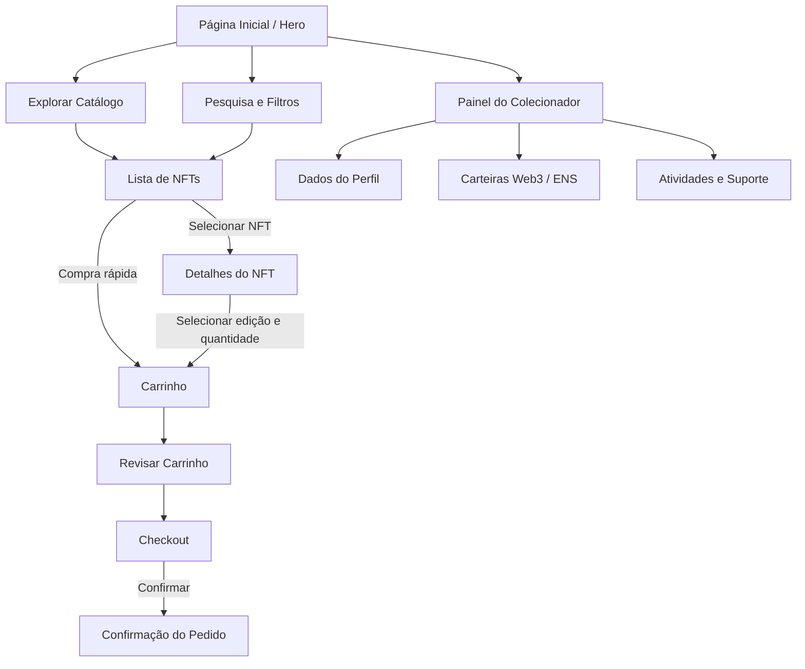

 <div align="center">

# 🎨 KURIO

### DIGITAL EXCLUSIVITY MARKETPLACE

**Exclusividade digital. Arte, tecnologia e colecionáveis em um só lugar.**


[Visão Geral](#-visão-geral) • [Funcionalidades](#-funcionalidades) • [Tecnologias](#-tecnologias) • [Instalação](#-instalação) • [Testes](#-testes-automatizados) • [Deploy](#-deploy) • [Licença](#-licença)

</div>

---

# ✨ Visão Geral

O **KURIO** é um marketplace de NFTs desenvolvido para proporcionar uma experiência moderna, intuitiva e imersiva na descoberta e comercialização de colecionáveis digitais exclusivos.

A plataforma combina uma interface elegante com funcionalidades de navegação, pesquisa, filtragem, visualização detalhada de colecionáveis, gerenciamento de perfil e simulação de compra.

Inspirado no universo dos marketplaces Web3 e dos colecionáveis digitais, o KURIO busca unir tecnologia, exclusividade e experiência do usuário em um único ambiente.

Mais do que uma vitrine digital, o projeto representa uma aplicação prática de desenvolvimento Front-end moderno, organização de componentes, gerenciamento de estados, responsividade e automação de testes.

> **Proposta:** transformar a experiência de explorar e colecionar ativos digitais em uma jornada simples, visualmente atraente e funcional.

## 🎯 Objetivos do projeto

- Desenvolver um marketplace de NFTs com identidade visual própria.
- Criar uma experiência de navegação moderna e responsiva.
- Facilitar a descoberta de colecionáveis digitais.
- Implementar filtros combinados e pesquisa dinâmica.
- Apresentar informações detalhadas de cada NFT.
- Desenvolver um fluxo de carrinho e checkout.
- Criar um painel de gerenciamento do colecionador.
- Aplicar boas práticas de desenvolvimento com React.
- Implementar testes automatizados utilizando Playwright.
- Preparar a estrutura para futuras integrações com tecnologias Web3.

---

# 🚀 Funcionalidades

## 1. 🖼️ Catálogo e exploração de NFTs

O catálogo é o principal ambiente de descoberta do marketplace.

Funcionalidades:

- Exibição de colecionáveis digitais em cards.
- Organização por coleções e categorias.
- Seções de lançamentos e itens em alta.
- Pesquisa em tempo real por nome.
- Pesquisa por atributos dos colecionáveis.
- Navegação entre os diferentes itens.
- Apresentação de informações e preços em ETH.

## 2. 🔍 Sistema de filtros

O KURIO permite refinar a exploração dos NFTs por meio de filtros.

Recursos:

- Filtragem por categorias.
- Seleção de faixa de preço.
- Pesquisa combinada com filtros.
- Atualização dinâmica dos resultados.
- Organização dos itens conforme os critérios selecionados.

## 3. 🎨 Detalhamento dos colecionáveis

Cada NFT possui uma visualização dedicada para apresentar suas informações.

Recursos:

- Galeria de imagens.
- Miniaturas para navegação visual.
- Nome e descrição do colecionável.
- Informações sobre a coleção.
- Exibição de atributos.
- Seleção de edições disponíveis.
- Controle de quantidade.
- Área de avaliações da comunidade.

### Modelos de edição

| Edição | Descrição                               |
| ------ | --------------------------------------- |
| 1/1    | Colecionável único                      |
| 1/10   | Edição limitada a 10 unidades           |
| 1/50   | Edição limitada a 50 unidades           |
| Aberta | Edição sem quantidade limitada definida |

## 4. 🛒 Carrinho de compras

O sistema conta com um carrinho em formato Side Drawer, permitindo acompanhar os itens selecionados sem abandonar a navegação.

Funcionalidades:

- Adicionar NFTs ao carrinho.
- Visualizar os itens selecionados.
- Alterar quantidades.
- Remover produtos.
- Calcular subtotais.
- Apresentar o valor total em ETH.
- Continuar explorando o catálogo.
- Avançar para o checkout.

## 5. 💳 Checkout e confirmação

O fluxo de checkout foi pensado para proporcionar uma experiência de compra organizada.

Etapas:

1. Revisão dos itens selecionados.
2. Conferência das quantidades.
3. Visualização do total.
4. Preenchimento das informações solicitadas.
5. Confirmação do fluxo.
6. Apresentação da confirmação do pedido.

**Importante:** o checkout demonstrativo não representa, por si só, uma transação financeira real ou uma operação validada em blockchain. Para isso, são necessárias integrações específicas.

## 6. 👤 Painel do colecionador

O ambiente de perfil centraliza as informações e configurações do usuário.

Recursos previstos na interface:

- Gerenciamento dos dados pessoais.
- Personalização do avatar.
- Informações do perfil.
- Alteração de senha.
- Gerenciamento de endereços ENS.
- Opções de conexão de carteiras Web3.
- Visualização de atividades.
- Área de suporte.

### Carteiras contempladas

- MetaMask.
- WalletConnect.
- Coinbase Wallet.

A apresentação dessas opções na interface não significa que a integração com as carteiras esteja operacional. A conexão real depende da implementação das respectivas bibliotecas e provedores.

## 7. 📱 Responsividade

A interface foi desenvolvida considerando diferentes dimensões de tela.

A experiência contempla:

- Desktop.
- Notebooks.
- Tablets.
- Smartphones.

A responsividade também faz parte dos cenários previstos na suíte de testes automatizados.

---

# 🔄 Fluxograma do sistema

O fluxo abaixo representa a jornada principal de navegação dentro do KURIO.



---

# 🛠️ Tecnologias

O projeto utiliza tecnologias modernas do ecossistema JavaScript.

| Tecnologia      | Aplicação                           |
| --------------- | ----------------------------------- |
| React 18        | Construção da interface             |
| Vite 5          | Ambiente de desenvolvimento e build |
| JavaScript ES6+ | Lógica da aplicação                 |
| Tailwind CSS 3  | Estilização e responsividade        |
| Lucide React    | Biblioteca de ícones                |
| Playwright      | Testes automatizados E2E            |
| Git             | Controle de versão                  |
| GitHub          | Hospedagem do código                |

## 🧩 Arquitetura da aplicação

O projeto utiliza uma estrutura baseada em componentes, permitindo separar responsabilidades e facilitar a manutenção.

Principais responsabilidades:

- **App.jsx:** componente principal e orquestração da aplicação.
- **Components:** componentes reutilizáveis da interface.
- **Data:** centralização dos dados demonstrativos.
- **Assets:** recursos visuais e elementos auxiliares.
- **Tests:** cenários automatizados de validação.

---

# 📁 Estrutura de pastas

```text
KURIO-Marketplace-NFT/
│
├── public/
│   └── images/
│       └── NFTs e imagens estáticas
│
├── src/
│   │
│   ├── components/
│   │   ├── Navbar
│   │   ├── Footer
│   │   ├── CartDrawer
│   │   ├── NFTCard
│   │   └── Demais componentes
│   │
│   ├── data/
│   │   └── nfts.js
│   │
│   ├── App.jsx
│   ├── index.css
│   └── main.jsx
│
├── tests/
│   └── e2e/
│       └── marketplace.spec.js
│
├── index.html
├── package.json
├── package-lock.json
├── playwright.config.js
├── postcss.config.js
├── tailwind.config.js
├── vite.config.js
├── .gitignore
├── LICENSE
└── README.md
```

_Observação: a estrutura acima representa a organização documentada do projeto. Alguns componentes podem estar organizados de maneira diferente na implementação atual._

---

# 💻 Instalação

## Pré-requisitos

Antes de executar o projeto, certifique-se de possuir:

- Node.js 18 ou superior.
- npm ou Yarn.
- Git.
- Navegador atualizado.

Links oficiais:

- [Node.js](https://nodejs.org/)
- [Git](https://git-scm.com/)
- [Visual Studio Code](https://code.visualstudio.com/)

Para verificar se tudo está instalado:

```bash
node --version
npm --version
git --version
```

## 1. Clonando o repositório

```bash
git clone https://github.com/SEU_USUARIO/KURIO-Marketplace-NFT.git
```

Entre na pasta:

```bash
cd KURIO-Marketplace-NFT
```

Substitua `SEU_USUARIO` pelo endereço correto do repositório.

## 2. Instalando as dependências

Execute:

```bash
npm install
```

Esse comando instalará as dependências definidas no `package.json`.

## 3. Executando o projeto

Inicie o servidor de desenvolvimento:

```bash
npm run dev
```

Após iniciar, acesse:

```text
http://localhost:5173
```

O Vite disponibilizará a aplicação localmente.

## 4. Gerando a versão de produção

Para gerar os arquivos otimizados:

```bash
npm run build
```

Os arquivos serão disponibilizados na pasta:

```text
dist/
```

## 5. Visualizando a build

Para testar a versão de produção localmente:

```bash
npm run preview
```

---

# 🧪 Testes automatizados

O KURIO utiliza Playwright para estruturar testes automatizados de ponta a ponta.

O objetivo é validar os principais fluxos de navegação e interação, reduzindo falhas e garantindo maior confiabilidade da interface.

## Configuração inicial

Instale os navegadores necessários:

```bash
npx playwright install
```

No Linux, caso necessário:

```bash
npx playwright install --with-deps
```

## Executar todos os testes

```bash
npx playwright test
```

Ou, caso o script esteja configurado:

```bash
npm run test:e2e
```

## Executar em modo visual

```bash
npx playwright test --ui
```

Ou:

```bash
npm run test:e2e:ui
```

## Gerar relatório HTML

```bash
npx playwright show-report
```

Ou:

```bash
npm run test:e2e:report
```

## Cenários de testes previstos

| Cenário        | Objetivo                         |
| -------------- | -------------------------------- |
| Página inicial | Validar carregamento             |
| Catálogo       | Verificar exibição dos NFTs      |
| Pesquisa       | Validar resultados               |
| Filtros        | Verificar filtragem              |
| Detalhes       | Abrir colecionáveis              |
| Edições        | Selecionar opções disponíveis    |
| Carrinho       | Adicionar e remover itens        |
| Quantidades    | Validar atualização              |
| Checkout       | Validar fluxo demonstrativo      |
| Perfil         | Verificar navegação              |
| Responsividade | Validar layouts desktop e mobile |

Os cenários efetivamente cobertos dependem da implementação presente em `tests/e2e/marketplace.spec.js`.

---

# 🎨 Personalização

## Cadastro de novos NFTs

Os dados demonstrativos do catálogo estão organizados em:

```text
src/data/nfts.js
```

Para adicionar novos colecionáveis, mantenha um padrão consistente de informações, como:

- Identificador.
- Nome.
- Descrição.
- Imagem.
- Categoria.
- Preço.
- Coleção.
- Atributos.
- Edições disponíveis.

## Imagens

As imagens estáticas podem ser organizadas em:

```text
public/images/
```

Exemplo de utilização:

```jsx

```

Recomenda-se utilizar imagens otimizadas em WebP ou AVIF, preservando a qualidade visual e reduzindo o tempo de carregamento.

Utilize apenas imagens e artes que você tenha autorização para publicar.

## Estilização

Os principais arquivos relacionados à aparência são:

```text
src/index.css
tailwind.config.js
```

Neles podem ser organizados:

- Cores.
- Tipografia.
- Espaçamentos.
- Animações.
- Componentes visuais.
- Configurações responsivas.

---

# ☁️ Deploy

O KURIO pode ser publicado em plataformas de hospedagem de aplicações front-end.

Como o projeto utiliza Vite, o processo de publicação consiste em gerar a build e disponibilizar o conteúdo da pasta `dist`.

## 1. Vercel

<https://vercel.com/>

Uma das opções recomendadas para publicação de aplicações React.

Configurações:

| Configuração     | Valor           |
| ---------------- | --------------- |
| Framework        | Vite            |
| Build Command    | `npm run build` |
| Output Directory | `dist`          |
| Install Command  | `npm install`   |

Passos:

1. Envie o projeto para o GitHub.
2. Acesse a Vercel.
3. Importe o repositório.
4. Configure os comandos de build.
5. Clique em Deploy.
6. Aguarde a publicação.

## 2. Netlify

<https://www.netlify.com/>

Também permite publicar aplicações React e Vite.

Configurações:

```text
Build command:
npm run build

Publish directory:
dist
```

Após configurar, conecte o repositório e realize a publicação.

## 3. GitHub Pages

<https://pages.github.com/>

O GitHub Pages pode hospedar a aplicação, desde que a configuração de caminho base (`base`) do Vite esteja correta para o endereço utilizado.

Também será necessário configurar o processo de build e publicação.

## Atenção ao roteamento

Caso a aplicação utilize rotas internas no navegador, configure o fallback do provedor para direcionar rotas não encontradas ao `index.html`.

Isso evita erros 404 quando o usuário acessa diretamente uma página interna.

---

# 🔐 Evolução para Web3

O KURIO possui uma proposta alinhada ao universo de NFTs e tecnologias descentralizadas.

Para transformar a interface em um marketplace Web3 efetivamente operacional, algumas integrações podem ser implementadas.

### 1. Conexão com carteiras

Possíveis tecnologias:

- MetaMask.
- WalletConnect.
- Coinbase Wallet.
- Ethers.js.
- Wagmi.

### 2. Smart Contracts

Contratos inteligentes podem ser utilizados para:

- Mint de NFTs.
- Transferência de ativos.
- Compra e venda.
- Gerenciamento de coleções.
- Registro de transações.

### 3. Armazenamento descentralizado

Possíveis tecnologias:

- IPFS.
- Pinata.
- Arweave.

### 4. Backend e banco de dados

Uma infraestrutura de backend pode permitir:

- Autenticação.
- Gerenciamento de usuários.
- Cadastro de coleções.
- Persistência de pedidos.
- Histórico de transações.
- Administração do marketplace.

### 5. Segurança

Para uma implementação real, é importante considerar:

- Validação das operações no servidor.
- Proteção de endpoints.
- Auditoria de smart contracts.
- Monitoramento de transações.
- Proteção contra operações maliciosas.
- Testes de segurança.

**Nunca solicite ou armazene frases-semente ou chaves privadas de carteiras.** As operações devem ser aprovadas pelo próprio usuário em sua carteira.

---

# 🗺️ Roadmap

Possíveis evoluções para o KURIO:

- [x] Estrutura inicial do marketplace.
- [x] Interface de exploração de NFTs.
- [x] Organização por coleções.
- [x] Sistema de pesquisa e filtros.
- [x] Visualização detalhada dos colecionáveis.
- [x] Estrutura de carrinho.
- [x] Fluxo demonstrativo de checkout.
- [x] Painel do colecionador.
- [x] Estrutura de testes E2E com Playwright.
- [x] Planejamento de responsividade.
- [ ] Integração real com carteiras Web3.
- [ ] Backend e banco de dados.
- [ ] Autenticação e persistência de usuários.
- [ ] Smart Contracts.
- [ ] Mint de NFTs.
- [ ] Integração com IPFS.
- [ ] Histórico real de transações.
- [ ] Pipeline CI/CD.
- [ ] Monitoramento e observabilidade.

_As marcações de conclusão devem refletir o estado real de cada funcionalidade no repositório._

---

# 🛠️ Solução de problemas

### Erro ao executar npm install

Verifique a versão do Node.js e tente reinstalar as dependências.

Windows PowerShell:

```powershell
Remove-Item -Recurse -Force node_modules
npm install
```

Linux / macOS:

```bash
rm -rf node_modules
npm install
```

### Porta 5173 ocupada

O Vite poderá disponibilizar outra porta automaticamente.

Confira o endereço apresentado no terminal.

### Playwright não encontra os navegadores

Execute:

```bash
npx playwright install
```

### Imagens não carregam

Verifique:

- Se os arquivos realmente existem.
- Se os caminhos estão corretos.
- Se os nomes respeitam maiúsculas e minúsculas.
- Se as imagens estão dentro da pasta esperada.

### Erro 404 após publicação

Se o projeto utiliza roteamento interno, configure o redirecionamento para `index.html` na hospedagem.

---

# 🤝 Contribuição

Contribuições são bem-vindas!

Caso queira colaborar:

**1. Faça um Fork**

Crie uma cópia do repositório em sua conta.

**2. Crie uma branch**

```bash
git checkout -b feat/nova-funcionalidade
```

**3. Desenvolva sua melhoria**

Mantenha o padrão de organização do projeto.

**4. Faça o commit**

```bash
git add .
git commit -m "feat: adiciona nova funcionalidade"
```

**5. Envie sua branch**

```bash
git push origin feat/nova-funcionalidade
```

**6. Abra um Pull Request**

Explique as alterações realizadas e como validar a implementação.

---

# 📄 Licença

Este projeto está disponibilizado sob a licença **MIT**.

Consulte o arquivo [`LICENSE`](./LICENSE) para obter os termos completos.

Caso o arquivo ainda não exista, adicione a licença à raiz do repositório antes de declarar formalmente essa distribuição.

---

<div align="center">

## KURIO

**Exclusividade digital para quem valoriza o extraordinário.**

Arte • Tecnologia • Colecionáveis • Inovação

Desenvolvido com React, Vite e dedicação aos detalhes.

⭐ Se este projeto chamou sua atenção, considere deixar uma estrela no repositório!

</div>
